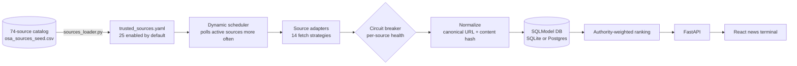

# Loud Hawk · Aviation News Aggregator

[](https://github.com/PhelipeHonesto/Aviation-News-Aggregator/actions/workflows/ci.yml)


**The ingestion engine behind [Loud Hawk](https://loudhawk.media), an aviation intelligence newsletter.** It polls regulators, manufacturers, airlines, trade press, and data providers, normalizes what they publish, removes duplicates across syndication, and ranks stories by source authority so the FAA outranks a blog repost of the FAA.

Aviation news is scattered across sources that don't play nicely. NTSB and EASA serve malformed RSS. OEM newsrooms have no feed at all. Half the trade press syndicates the same wire story. This project treats each source as a reliability problem and gives every one a fetch strategy and a health record.

---

## How it works



| Piece | What it does |
| --- | --- |
| **Source catalog** | 74 sources across regulators (FAA, NTSB, EASA, ICAO, Transport Canada, UK CAA, CASA), OEMs, airlines, trade press, industry bodies, data providers, and eVTOL companies. 25 are enabled by default; `python sources_loader.py` regenerates the active list from the catalog |
| **Adapters** | 14 fetch strategies: native RSS, redirected RSS discovery, RSS with malformed-XML recovery, sitemap discovery, HTML scraping with CSS selectors and content whitelists, WordPress / JSON APIs, YouTube, plus fallbacks between them |
| **Source health** | Per-source circuit breaker. Repeated 4xx errors or timeouts disable a source automatically instead of wasting a poll cycle on it every run |
| **Dynamic scheduler** | Changes how often each source is polled based on how often it actually publishes |
| **Dedup** | Unique canonical URL plus a content fingerprint (URL, title, and date), which catches the same story syndicated across outlets |
| **Ranking** | Authority weights by source tier (regulators, then OEMs, then airlines and press), combined with recency and content-quality signals |

## Quickstart

### Docker

```bash
make dev        # backend + frontend with hot reload
make status
make logs
```

### Local

```bash
# Backend (Python 3.11)
cd backend
python3.11 -m venv .venv && source .venv/bin/activate
pip install -r requirements.txt
python main.py                 # http://localhost:8000, docs at /docs

# Frontend
cd frontend
npm install
npm run dev                    # http://localhost:5173
```

Start a harvest with `POST /ingest`, or let the scheduler run (`SCHEDULER_ENABLED=true` by default).

### API

| Endpoint | Purpose |
| --- | --- |
| `GET /news` | Ranked articles, filter by source, cursor pagination |
| `GET /search?q=` | Keyword search |
| `GET /sources` · `GET /sources/health` | Source registry and per-source reliability |
| `GET /sources/activity` · `GET /ranking/stats` | Scheduler and ranking telemetry |
| `POST /ingest` | Run a harvest now |
| `GET /bookmarks` | Saved articles |
| `GET /health` · `/readyz` · `/healthz` | Health, readiness, and liveness probes |

## Tests and CI

```bash
cd backend && python -m pytest -q tests      # API smoke tests, run offline
cd frontend && npm run lint && npm run build
```

CI runs both on every push. The backend tests boot the app against a temporary database with the scheduler disabled. They check the core routes and confirm that the catalog (74) and the active source list (25) load.

## Repository map

```
backend/
  main.py               FastAPI app and routes
  ingest.py             harvest pipeline
  source_adapters.py    fetch strategies
  source_health.py      circuit breaker and reliability tracking
  dynamic_scheduler.py  adaptive polling
  ranking_system.py     authority-weighted ranking
  models.py             SQLModel models: canonical URL + content-hash dedup
  osa_sources_seed.csv  74-source catalog
  trusted_sources.yaml  active source list
frontend/
  src/pages/NewsTerminal.tsx   news terminal UI
```

## Part of the OSA stack

| Repo | Role |
| --- | --- |
| [dumont-agent](https://github.com/PhelipeHonesto/dumont-agent) | Charter-brokerage agent |
| [osa-data-platform](https://github.com/PhelipeHonesto/osa-data-platform) | Aviation data ingestion and entity resolution |
| [ph-brain-engine](https://github.com/PhelipeHonesto/ph-brain-engine) | Memory substrate served over MCP |
| **Aviation-News-Aggregator** (this repo) | Loud Hawk news and signals |

## License

MIT. See [LICENSE](LICENSE).
